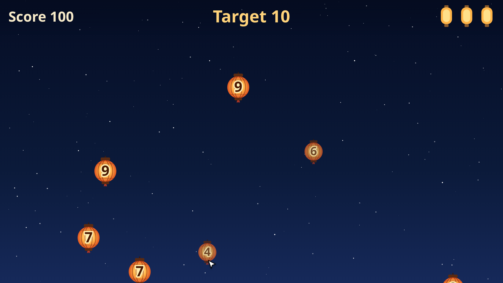
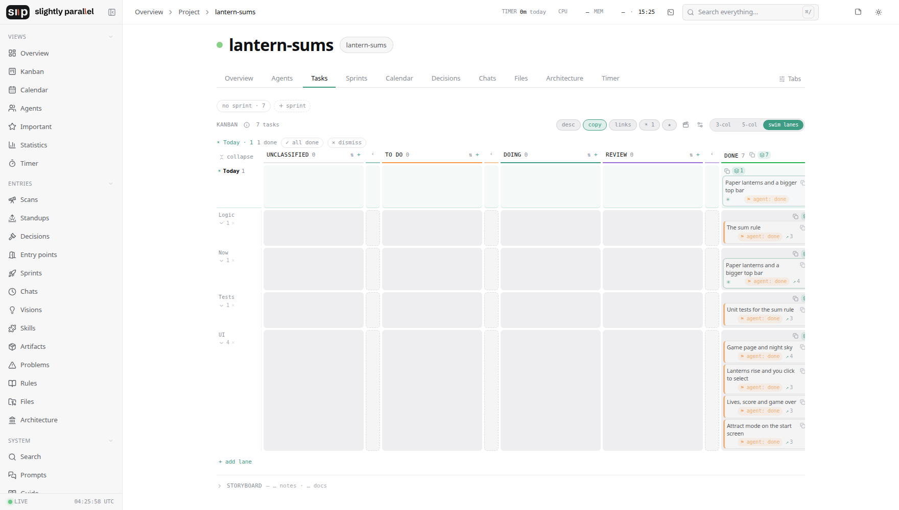
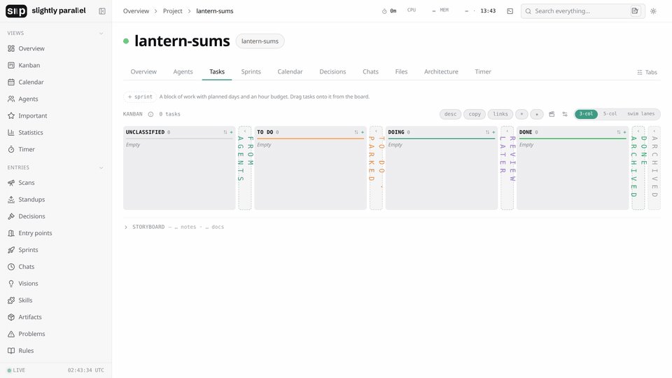

# Lantern Sums

A small browser game built from scratch with Claude Code, as an example of how to do it.
It goes with the video **[Build a Browser Game from Scratch with Claude Code and Slightly Parallel](https://www.youtube.com/watch?v=LwgZup5XRV8)**.

▶ **Play:** https://nmar33.github.io/lantern-sums/

Lanterns rise with numbers on them. Click the ones that add up to 10 before they fly away. Miss three and the game is over.



The work was planned and tracked with [Slightly Parallel](https://github.com/NMar33/slightly-parallel):
six cards on a Kanban board, handed to two Claude Code sessions working at the same time.

## The board



How the cards were written:



| Lane | Card | Session | Commit |
|---|---|---|---|
| UI | [Game page and night sky](cards/01-game-page-and-night-sky.md) | 1 | 1645a43 |
| Logic | [The sum rule](cards/02-the-sum-rule.md) | 1 | 2eab4df |
| Tests | [Unit tests for the sum rule](cards/03-unit-tests-for-the-sum-rule.md) | 2 | 7334a7c |
| UI | [Lanterns rise and you click to select](cards/04-lanterns-rise-and-you-click-to-select.md) | 1 | 12387c1 |
| UI | [Lives, score and game over](cards/05-lives-score-and-game-over.md) | 1 | 92e58bc |
| UI | [Attract mode on the start screen](cards/06-attract-mode-on-the-start-screen.md) | 1 | 5fb1083 |
| Now | [Paper lanterns and a bigger top bar](cards/07-paper-lanterns-and-a-bigger-top-bar.md) | 1 | 3c7de11 |

Each card's file holds its text as it was pasted into Claude Code. The git history has one commit per card.

## Prompts, in order

Everything typed into the two Claude Code sessions, word for word.

1. Session 1: card 1, pasted.
2. Session 1: `#done`
3. Session 1: card 2, pasted. Session 2: card 3, pasted.
4. Session 1: `#done`
5. Session 2: `Two test files now cover the same rules. Keep tests/logic.test.js, delete logic.test.mjs at the root, and run node --test again.`
6. Session 2: `#done`
7. Session 1: card 4, pasted, then `#done`.
8. Session 1: card 5, pasted, then `#done`.
9. Session 1: card 6, pasted, then `#done`.
10. Session 1: `#now The lanterns are plain circles: make them look like paper lanterns. And the top bar is too small to read: make the score, the target and the lives about twice as big.`
11. Session 1: `Better. But the lanterns are now small and the numbers are hard to read. Make the lanterns about 50% bigger, with bigger numbers.`
12. Session 1: `#done`
13. Session 1: `Commit the work: one commit per card, with the card's id in each message.`

`#done` and `#now` are Slightly Parallel commands typed in the chat: `#done` moves the card to Done, `#now` puts the request on the board as a new card.

## Run it

```sh
python3 -m http.server
```

Then open http://localhost:8000. Tests: `node --test tests/logic.test.js`.

No libraries, no build step.

## License

MIT
